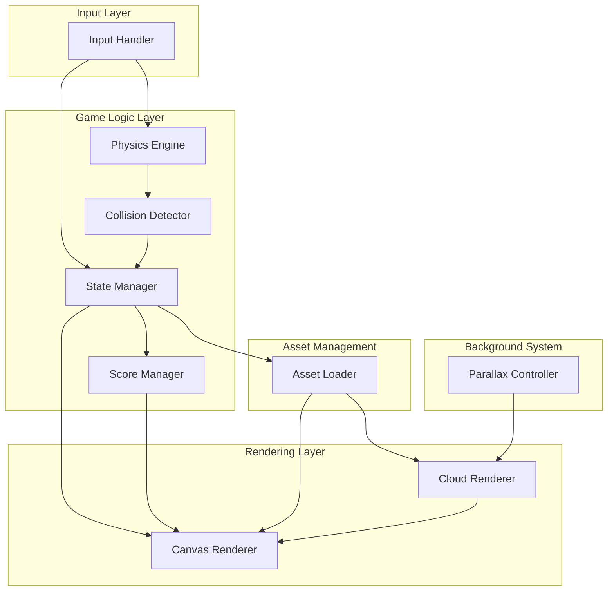

# Flappy Kiro Design Document

## Overview

Flappy Kiro is a retro browser-based endless scroller game where the player guides a ghost character named Kiro through a series of obstacles (pipes). The game features pixel-art visuals, retro sound effects, and simple tap-to-jump mechanics inspired by the classic Flappy Bird gameplay style. The objective is to navigate as far as possible without colliding with pipes or the ground, accumulating a score based on distance traveled and pipes successfully passed.

This design document outlines the technical architecture, components, interfaces, data models, correctness properties, error handling, and testing strategy for implementing Flappy Kiro as a complete, playable web-based game. The implementation uses pure vanilla HTML5 Canvas and JavaScript with no external dependencies or build tools, ensuring maximum compatibility and minimal load times.

The game operates on a 60 FPS game loop that processes user input, updates physics, handles collisions, and renders graphics to the canvas. Players control Kiro's vertical movement through spacebar presses or mouse/touch clicks, navigating through randomly generated pipe obstacles. The game includes progressive difficulty scaling, a persistent high score system, retro audio effects, and a multi-layer parallax background for visual depth.

## Architecture

Flappy Kiro follows a component-based architecture with clear separation between game state management, physics simulation, rendering logic, and user input handling. The architecture consists of three primary layers working in concert: the Input Layer processes user interactions and converts them into game actions, the Game Logic Layer maintains the game state and applies physics calculations, and the Rendering Layer draws the current game state to the HTML5 Canvas.

The game loop follows a standard pattern where the update() function modifies the game state based on elapsed time and user input, while the draw() function renders the current state to the canvas. This separation allows for easier testing and maintenance of individual game components. The physics system uses simplified gravity and velocity calculations to create realistic-feeling bird movement. Collision detection is performed using rectangular bounding boxes that encompass each game entity.

Game state transitions are managed through a finite state machine with distinct states for the title screen, gameplay, and game over screens. Each state handles its own rendering and input processing, allowing for clean transitions between game modes. The architecture also includes an asset management system that preloads and caches game resources including images and audio files.

The architecture emphasizes modularity and testability, with each component exposing well-defined interfaces for interaction. Dependencies are injected where possible to facilitate unit testing and mocking. The event-driven input system allows for easy extension to support additional input methods or custom key bindings in future iterations.



## Components and Interfaces

### Input Handler

The Input Handler component manages all user interaction with the game. It listens for keyboard events (spacebar, P, ESC) and mouse/touch events (clicks and taps). The handler maintains an input state that tracks whether the primary action button is currently pressed, allowing other components to query input status. The handler also implements debouncing to prevent multiple rapid inputs from being registered in quick succession. Each input event is translated into a game action that is passed to the Game State Manager.

**Interface:**
```typescript
interface InputHandler {
    isJumpPressed(): boolean;
    isPausePressed(): boolean;
    onJump(callback: () => void): void;
    onPause(callback: () => void): void;
    onRestart(callback: () => void): void;
}
```

### Physics Engine

The Physics Engine component calculates position, velocity, and acceleration for Kiro based on gravity and jump inputs. It maintains the vertical velocity (Velocity_Y) and applies gravity each frame, clamping the velocity to terminal velocity limits. The engine also calculates sprite rotation based on vertical movement direction, providing visual feedback for the player's actions.

**Interface:**
```typescript
interface PhysicsEngine {
    applyJump(): void;
    update(deltaTime: number): void;
    getVelocity(): number;
    getPosition(): { x: number, y: number };
    getRotation(): number;
    reset(): void;
}
```

### Game State Manager

The Game State Manager component controls the overall game flow and maintains the current state of gameplay. It implements a state machine with clear transitions between Title, Playing, Paused, and GameOver states. The state manager receives input events and delegates them to the appropriate handler based on the current state. When transitioning between states, the manager initializes new game objects, resets scores, and triggers any necessary animations or audio effects.

**Interface:**
```typescript
interface GameStateManager {
    getState(): GameState;
    transitionTo(state: GameState): void;
    handleInput(input: GameInput): void;
    update(deltaTime: number): void;
}
```

### Collision Detector

The Collision Detector component performs frame-by-frame collision checks between game entities. It implements three distinct detection algorithms optimized for each collision type. The detector checks Kiro's collision volume against obstacles, the ground, and the ceiling, triggering the appropriate game state transitions when collisions occur.

**Interface:**
```typescript
interface CollisionDetector {
    checkKiroPipeCollision(kiro: Kiro, pipe: Pipe): boolean;
    checkKiroBoundaryCollision(kiro: Kiro): { ceiling: boolean, ground: boolean };
    getKiroHitbox(kiro: Kiro): CircleHitbox;
    getPipeHitbox(pipe: Pipe, isUpper: boolean): RectangleHitbox;
}
```

#### Algorithm 1: Circular Collision (Kiro vs Pipe)

Kiro is treated as a circle for more forgiving and organic collision detection against pipes. The algorithm checks if the distance between the circle center and the closest point on the rectangle is less than the circle radius.

```typescript
interface CircleHitbox {
    type: 'circle';
    centerX: number;      // Kiro center X (sprite center)
    centerY: number;      // Kiro center Y (sprite center)
    radius: number;       // CONFIG.hitbox.width / 2
}

interface RectangleHitbox {
    type: 'rectangle';
    x: number;            // Left edge
    y: number;            // Top edge
    width: number;        // Pipe width
    height: number;       // Pipe segment height
}

function checkCircleRectangleCollision(circle: CircleHitbox, rect: RectangleHitbox): boolean {
    // Find the closest point on the rectangle to the circle center
    const closestX = Math.max(rect.x, Math.min(circle.centerX, rect.x + rect.width));
    const closestY = Math.max(rect.y, Math.min(circle.centerY, rect.y + rect.height));
    
    // Calculate distance from circle center to closest point
    const distanceX = circle.centerX - closestX;
    const distanceY = circle.centerY - closestY;
    
    // Check if distance is less than circle radius
    const distanceSquared = (distanceX * distanceX) + (distanceY * distanceY);
    const radiusSquared = circle.radius * circle.radius;
    
    return distanceSquared < radiusSquared;
}

// Usage in CollisionDetector:
checkKiroPipeCollision(kiro: Kiro, pipe: Pipe): boolean {
    const kiroHitbox = this.getKiroHitbox(kiro);
    const upperHitbox = this.getPipeHitbox(pipe, true);
    const lowerHitbox = this.getPipeHitbox(pipe, false);
    
    return this.checkCircleRectangleCollision(kiroHitbox, upperHitbox) ||
           this.checkCircleRectangleCollision(kiroHitbox, lowerHitbox);
}
```

#### Algorithm 2: Rectangular AABB Collision (Pipe Cap Overlap)

For precise pipe cap collision, use Axis-Aligned Bounding Box intersection. This handles the rounded caps on pipe ends.

```typescript
interface AABB {
    x: number;      // Left edge
    y: number;      // Top edge
    width: number;
    height: number;
}

function checkAABBIntersection(a: AABB, b: AABB): boolean {
    return a.x < b.x + b.width &&
           a.x + a.width > b.x &&
           a.y < b.y + b.height &&
           a.y + a.height > b.y;
}

// Pipe cap is a 10x10 pixel rounded rectangle at each pipe end
interface PipeCap {
    x: number;           // Left edge
    y: number;           // Top edge
    width: number;       // 10 pixels
    height: number;      // 10 pixels
}

function checkPipeCapCollision(kiro: AABB, cap: PipeCap): boolean {
    return checkAABBIntersection(kiro, cap);
}
```

#### Algorithm 3: Ground and Ceiling Detection

Boundary collision uses simple coordinate comparisons against canvas dimensions.

```typescript
interface BoundaryCollision {
    ceiling: boolean;    // Kiro went above canvas
    ground: boolean;     // Kiro went below canvas
}

interface KiroState {
    x: number;           // Horizontal position
    y: number;           // Vertical position (center)
    radius: number;      // CONFIG.hitbox.width / 2
}

checkKiroBoundaryCollision(kiro: Kiro): BoundaryCollision {
    const { width: canvasWidth, height: canvasHeight } = this.canvas.getDimensions();
    const radius = CONFIG.hitbox.width / 2;
    
    // Ceiling: top of hitbox above canvas (y - radius < 0)
    const ceilingCollision = (kiro.y - radius) < 0;
    
    // Ground: bottom of hitbox below canvas (y + radius > canvasHeight)
    const groundCollision = (kiro.y + radius) > canvasHeight;
    
    return { ceiling: ceilingCollision, ground: groundCollision };
}
```

#### Algorithm 4: Combined Collision Check

The complete collision detection sequence runs each frame:

```typescript
interface CollisionResult {
    collided: boolean;
    collisionType: 'PIPE_UPPER' | 'PIPE_LOWER' | 'CAP_UPPER' | 'CAP_LOWER' | 'CEILING' | 'GROUND' | null;
    kiroHitbox: CircleHitbox;
    timestamp: number;
}

function checkAllCollisions(kiro: Kiro, pipes: Pipe[]): CollisionResult {
    const kiroHitbox = this.getKiroHitbox(kiro);
    
    // Check boundaries first (fastest)
    const boundaryResult = this.checkKiroBoundaryCollision(kiro);
    if (boundaryResult.ceiling) {
        return { collided: true, collisionType: 'CEILING', kiroHitbox, timestamp: Date.now() };
    }
    if (boundaryResult.ground) {
        return { collided: true, collisionType: 'GROUND', kiroHitbox, timestamp: Date.now() };
    }
    
    // Check each pipe for collision
    for (const pipe of pipes) {
        // Check main pipe body (rectangular)
        if (this.checkKiroPipeCollision(kiro, pipe)) {
            return { collided: true, collisionType: 'PIPE', kiroHitbox, timestamp: Date.now() };
        }
        
        // Check decorative caps (AABB overlap)
        if (this.checkCapCollisions(kiro, pipe)) {
            return { collided: true, collisionType: 'CAP', kiroHitbox, timestamp: Date.now() };
        }
    }
    
    return { collided: false, collisionType: null, kiroHitbox, timestamp: Date.now() };
}
```

#### Hitbox Calculations

```typescript
// Kiro's circular hitbox is centered on the sprite
function getKiroHitbox(kiro: Kiro): CircleHitbox {
    return {
        type: 'circle',
        centerX: kiro.x + (CONFIG.hitbox.width / 2),
        centerY: kiro.y + (CONFIG.hitbox.height / 2),
        radius: CONFIG.hitbox.width / 2
    };
}

// Pipe hitbox covers the full pipe segment
function getPipeHitbox(pipe: Pipe, isUpper: boolean): RectangleHitbox {
    if (isUpper) {
        return {
            type: 'rectangle',
            x: pipe.x,
            y: 0,
            width: CONFIG.pipes.pipeWidth,
            height: pipe.gapPosition
        };
    } else {
        const gapBottom = pipe.gapPosition + pipe.gapHeight;
        return {
            type: 'rectangle',
            x: pipe.x,
            y: gapBottom,
            width: CONFIG.pipes.pipeWidth,
            height: CONFIG.visual.canvas.baseHeight - gapBottom
        };
    }
}
```

### Pipe Manager

The Pipe Manager handles the creation, movement, and cleanup of obstacles (pipes). It generates new obstacles at random intervals and positions while ensuring playability by maintaining minimum gap sizes. The manager maintains an array of active obstacles, updating their position each frame and removing obstacles that have moved off-screen. Each obstacle consists of top and bottom pipe sections with a gap that the player must navigate through.

**Interface:**
```typescript
interface PipeManager {
    getObstacles(): Obstacle[];
    update(deltaTime: number): void;
    reset(): void;
    getScorePosition(): number;
}
```

### Score Manager

The Score Manager component encapsulates scoring logic and persistence. It tracks the current session score, the persisted high score, and handles score increment when passing obstacles. The manager persists the high score to localStorage and provides methods for checking and updating high scores. The component includes validation to ensure scores remain non-negative.

**Interface:**
```typescript
interface ScoreManager {
    getCurrentScore(): number;
    getHighScore(): number;
    incrementScore(): void;
    checkHighScore(): boolean;
    reset(): void;
    saveHighScore(): void;
}
```

### Canvas Renderer

The Canvas Renderer component serves as the primary rendering surface for the game. It initializes an HTML5 Canvas element and maintains references to the 2D rendering context. The renderer provides methods for clearing the screen, drawing images, and rendering text. It also handles canvas resizing to accommodate different screen sizes while maintaining the game's aspect ratio.

**Interface:**
```typescript
interface CanvasRenderer {
    clear(): void;
    drawSprite(image: HTMLImageElement, x: number, y: number, rotation: number): void;
    drawText(text: string, x: number, y: number, font: string): void;
    drawRectangle(x: number, y: number, width: number, height: number, color: string): void;
    getDimensions(): { width: number, height: number };
}
```

### Cloud Renderer

The Cloud Renderer component handles the parallax cloud background system. It manages multiple cloud layers at different depths, each moving at different speeds to create visual depth. The renderer generates random cloud positions and handles cloud spawning and cleanup as they move off-screen.

**Interface:**
```typescript
interface CloudRenderer {
    update(deltaTime: number): void;
    render(ctx: CanvasRenderingContext2D): void;
    reset(): void;
}
```

### Asset Loader

The Asset Loader component manages the asynchronous loading of game resources including images and audio files. It implements a resource pool that tracks loading progress and ensures assets are fully loaded before gameplay begins. The loader exposes a simple interface for accessing loaded assets by name.

**Interface:**
```typescript
interface AssetLoader {
    loadImage(name: string, src: string): Promise<HTMLImageElement>;
    loadAudio(name: string, src: string): Promise<HTMLAudioElement>;
    getImage(name: string): HTMLImageElement | null;
    getAudio(name: string): HTMLAudioElement | null;
    areAllAssetsLoaded(): boolean;
}
```

### Audio Engine

The Audio Engine component handles sound effect playback for game events. It manages the Web Audio API context and provides methods for playing jump and game over sounds. The engine handles audio loading asynchronously and provides fallback behavior when audio playback is not available.

**Interface:**
```typescript
interface AudioEngine {
    playJump(): void;
    playGameOver(): void;
    loadAssets(): Promise<void>;
}
```

## Data Models

### Game State Model

The Game State Model defines the structure for tracking the overall game state throughout gameplay. This model contains the current game state, the current score, the high score, and timing information. The state model also tracks whether the game has been initialized and whether assets are loaded.

```typescript
type GameState = 'TITLE' | 'PLAYING' | 'PAUSED' | 'GAMEOVER';

interface GameStateModel {
    state: GameState;
    score: number;
    highScore: number;
    isInitialized: boolean;
    assetsLoaded: boolean;
    startTime: number;
    lastFrameTime: number;
}
```

### Bird Model

The Bird Model defines the data structure for the player character. It includes position coordinates, velocity values for vertical movement, and dimensions for collision calculations. The model tracks animation state for wing movement and gravity parameters for physics simulation.

```typescript
interface BirdModel {
    x: number;
    y: number;
    width: number;           // CONFIG.hitbox.spriteWidth
    height: number;          // CONFIG.hitbox.spriteHeight
    velocity: number;
    gravity: number;         // CONFIG.physics.gravity
    flapStrength: number;    // CONFIG.physics.jumpStrength
    animationFrame: number;
    animationTimer: number;
    rotation: number;
}
```

### Physics Constants Model

The Physics Constants Model defines the immutable values used throughout physics calculations. These constants are loaded from configuration and remain constant throughout gameplay.

```typescript
interface PhysicsConstants {
    gravity: number;           // CONFIG.physics.gravity
    jumpStrength: number;      // CONFIG.physics.jumpStrength
    terminalVelocity: number;  // CONFIG.physics.terminalVelocity
    horizontalVelocity: number;// CONFIG.physics.horizontalVelocity
    rotationRate: number;      // CONFIG.physics.rotationRate
    maxRotationUp: number;     // CONFIG.physics.maxRotationUp
    maxRotationDown: number;   // CONFIG.physics.maxRotationDown
}
```

### Obstacle Model

The Obstacle Model defines the structure for pipe obstacles. Each obstacle consists of two pipe sections (top and bottom) with a configurable gap between them. The model tracks the obstacle's position, gap information, and scoring status.

```typescript
interface ObstacleModel {
    x: number;
    y: number;
    width: number;            // CONFIG.pipes.pipeWidth
    gapHeight: number;        // CONFIG.pipes.baseGapHeight (dynamic based on score)
    gapPosition: number;
    passed: boolean;
    speed: number;            // CONFIG.physics.horizontalVelocity (dynamic based on score)
}
```

### Pipe Generation Settings Model

The Pipe Generation Settings Model defines the parameters used for pipe generation, including spacing, gap sizes, and difficulty scaling based on score.

```typescript
interface PipeGenerationSettings {
    wallPairSpacing: number;       // CONFIG.pipes.wallPairSpacing
    baseGapHeight: number;         // CONFIG.pipes.baseGapHeight
    pipeWidth: number;             // CONFIG.pipes.pipeWidth
    gapClearance: number;          // CONFIG.pipes.gapClearance
    minGapHeight: number;          // CONFIG.pipes.minGapHeight
    difficultyThresholds: number[];// CONFIG.pipes.difficultyThresholds
}
```

### Cloud Model

The Cloud Model defines the structure for parallax clouds. Each cloud has position, size, layer depth, and opacity for creating visual depth.

```typescript
interface CloudModel {
    x: number;
    y: number;
    width: number;
    height: number;
    layer: 'BACKGROUND' | 'MIDGROUND' | 'FOREGROUND';
    opacity: number;       // CONFIG.clouds.layers[layer].opacity
    speed: number;         // CONFIG.clouds.layers[layer].speed
}
```

### Hitbox Model

The Hitbox Model defines rectangular bounding boxes for collision detection. Hitboxes are typically smaller than rendered sprites to provide forgiving gameplay.

```typescript
interface HitboxModel {
    x: number;
    y: number;
    width: number;
    height: number;
}

interface Rectangle {
    x: number;
    y: number;
    width: number;
    height: number;
}
```

### Score Model

The Score Model encapsulates scoring configuration and status. It tracks the current session score and provides methods for score management.

```typescript
interface ScoreModel {
    currentScore: number;
    highScore: number;
    lastScore: number;
    storageKey: string;
}
```

### Asset Model

The Asset Model tracks the loading status and references for game resources. It maintains mappings between asset names and their loaded resources.

```typescript
interface AssetModel {
    name: string;
    type: 'IMAGE' | 'AUDIO';
    resource: HTMLImageElement | HTMLAudioElement;
    isLoaded: boolean;
    loadError: Error | null;
}
```

### Canvas Settings Model

The Canvas Settings Model defines the canvas dimensions and scaling parameters for responsive rendering.

```typescript
interface CanvasSettings {
    baseWidth: number;      // CONFIG.visual.canvas.baseWidth
    baseHeight: number;     // CONFIG.visual.canvas.baseHeight
    maxWidth: number;       // CONFIG.visual.canvas.maxWidth
    maxHeight: number;      // CONFIG.visual.canvas.maxHeight
    currentWidth: number;
    currentHeight: number;
}
```

### Death Animation Model

The Death Animation Model tracks the state of the death sequence animation that plays when Kiro collides with an obstacle.

```typescript
interface DeathAnimationModel {
    isPlaying: boolean;
    frame: number;
    totalFrames: number;    // CONFIG.game.deathSequenceFrames
    startOpacity: number;
    startRotation: number;
}
```

### Invincibility Model

The Invincibility Model tracks the invincibility frames that can be applied after game restart to prevent immediate re-collision.

```typescript
interface InvincibilityModel {
    framesRemaining: number;
    totalFrames: number;    // CONFIG.game.invincibilityFrames
    flashInterval: number;  // CONFIG.game.invincibilityFlashInterval
    isActive: boolean;
}
```

All model interfaces reference the central CONFIG object for default values. At runtime, actual values may differ from CONFIG defaults based on game progress (e.g., pipe speed increases as score rises).

## Configuration System

The Flappy Kiro game uses a centralized configuration file (`config.js`) that exports all tunable game parameters. This approach allows easy customization without modifying core game logic. All components import their constants from this module, ensuring consistency throughout the codebase.

### Config.js File Structure

```javascript
// config.js - Central game configuration
// All tunable parameters in one convenient location

// ============================================================================
// CENTRAL CONFIGURATION OBJECT
// ============================================================================
export const CONFIG = {
    // -----------------------------------------------------------------------
    // PHYSICS - Kiro's movement and gravity
    // -----------------------------------------------------------------------
    physics: {
        gravity: 0.25,              // Downward acceleration (px/frame²)
        jumpStrength: -4.5,         // Upward velocity on jump (px/frame)
        terminalVelocity: 8.0,      // Maximum fall speed (px/frame)
        horizontalVelocity: 2.0,    // Forward speed relative to pipes (px/frame)
        rotationRate: 3,            // Sprite rotation (degrees per 1 px/frame)
        maxRotationUp: 30,          // Maximum upward rotation (degrees)
        maxRotationDown: 90         // Maximum downward rotation (degrees)
    },

    // -----------------------------------------------------------------------
    // PIPES - Obstacle generation and difficulty scaling
    // -----------------------------------------------------------------------
    pipes: {
        wallPairSpacing: 90,        // Frames between pipe spawns
        baseGapHeight: 180,         // Initial gap size (pixels)
        minGapHeight: 140,          // Minimum gap size at max difficulty (pixels)
        pipeWidth: 60,              // Pipe segment width (pixels)
        gapClearance: 50,           // Minimum distance from canvas edges (pixels)
        difficultyThresholds: [10, 20, 30, 50],  // Score thresholds
        speedMultipliers: [1.0, 1.1, 1.2, 1.3, 1.5],  // Speed at each tier
        gapSizes: [180, 170, 160, 150, 140]  // Gap size at each tier
    },

    // -----------------------------------------------------------------------
    // CLOUDS - Parallax background configuration
    // -----------------------------------------------------------------------
    clouds: {
        layers: {
            background: { speed: 0.5, opacity: 0.5 },
            midground: { speed: 1.0, opacity: 0.65 },
            foreground: { speed: 2.0, opacity: 0.8 }
        },
        spawnInterval: 120,         // Frames between cloud spawns
        minCloudsPerLayer: 2,       // Minimum clouds per layer
        maxCloudsPerLayer: 5        // Maximum clouds per layer
    },

    // -----------------------------------------------------------------------
    // GAME - General gameplay settings
    // -----------------------------------------------------------------------
    game: {
        targetFPS: 60,              // Target frames per second
        deathSequenceFrames: 60,    // Death animation duration
        invincibilityFrames: 120,   // Post-restart invincibility
        invincibilityFlashInterval: 4,  // Flash toggle interval
        jumpDebounceMs: 50,         // Jump input debounce time (ms)
        assetLoadTimeout: 5000      // Max wait for asset loading (ms)
    },

    // -----------------------------------------------------------------------
    // SCORING - Score tracking and persistence
    // -----------------------------------------------------------------------
    scoring: {
        highScoreKey: 'flappyKiroHighScore',  // localStorage key
        pointsPerPipe: 1          // Points awarded per obstacle passed
    },

    // -----------------------------------------------------------------------
    // VISUAL - Colors, fonts, and rendering
    // -----------------------------------------------------------------------
    visual: {
        skyColor: '#70C5CE',
        pipeColor: '#00AA00',
        pipeOutline: '#004400',
        pipeOutlineWidth: 2,
        titleFont: '48px "Press Start 2P", monospace',
        scoreFont: '32px "Press Start 2P", monospace',
        textFont: '24px "Press Start 2P", monospace',
        textColor: '#FFFFFF',
        textOutline: '#000000',
        highScoreColor: '#FFD700',
        canvas: {
            baseWidth: 480,
            baseHeight: 640,
            maxWidth: 480,
            maxHeight: 640
        }
    },

    // -----------------------------------------------------------------------
    // HITBOX - Collision detection settings
    // -----------------------------------------------------------------------
    hitbox: {
        spriteWidth: 40,
        spriteHeight: 40,
        inset: 4,  // Hitbox inset from sprite edges
        get width() { return this.spriteWidth - (this.inset * 2); },
        get height() { return this.spriteHeight - (this.inset * 2); }
    }
};

// ============================================================================
// VALIDATION - Ensure configuration values are valid on import
// ============================================================================
function validateConfig() {
    const { physics, pipes, game } = CONFIG;

    if (physics.gravity <= 0) throw new Error('physics.gravity must be positive');
    if (physics.terminalVelocity < Math.abs(physics.jumpStrength)) {
        throw new Error('physics.terminalVelocity must exceed jumpStrength magnitude');
    }
    if (pipes.baseGapHeight < pipes.minGapHeight) {
        throw new Error('pipes.baseGapHeight must be >= pipes.minGapHeight');
    }
    if (game.targetFPS <= 0) throw new Error('game.targetFPS must be positive');
}

// Run validation immediately
validateConfig();

// ============================================================================
// BACKWARDS COMPATIBILITY - Individual exports for convenience
// ============================================================================
// These allow: import { PHYSICS } from './config.js';
export const PHYSICS = CONFIG.physics;
export const PIPES = CONFIG.pipes;
export const CLOUDS = CONFIG.clouds;
export const GAME = CONFIG.game;
export const SCORING = CONFIG.scoring;
export const VISUAL = CONFIG.visual;
export const HITBOX = CONFIG.hitbox;
```

### Configuration Usage Pattern

All game components import constants from config.js:

```javascript
import { CONFIG } from './config.js';

// Access values via CONFIG (recommended)
const gravity = CONFIG.physics.gravity;
const gapHeight = CONFIG.pipes.baseGapHeight;

// Or import individual sections for convenience
import { PHYSICS, PIPES } from './config.js';
const jumpStrength = PHYSICS.jumpStrength;
```

### Configuration Validation

The config.js file includes runtime validation via getter functions and constants:

```javascript
// Validate PHYSICS constants on import
if (PHYSICS.gravity <= 0) {
    throw new Error('PHYSICS.gravity must be positive');
}
if (PHYSICS.terminalVelocity < Math.abs(PHYSICS.jumpStrength)) {
    throw new Error('PHYSICS.terminalVelocity must exceed jumpStrength magnitude');
}
```

## Correctness Properties

*A property is a characteristic or behavior that should hold true across all valid executions of a system—essentially, a formal statement about what the system should do. Properties serve as the bridge between human-readable specifications and machine-verifiable correctness guarantees.*

### Property 1: Physics velocity clamping

*For any* game frame during active gameplay, the Physics Engine SHALL ensure that Kiro's vertical velocity remains within the defined terminal velocity bounds, where positive velocity is clamped to terminal velocity and negative velocity is clamped to negative terminal velocity.

**Validates: Requirements 1.3, 1.4**

### Property 2: Gravity accumulation

*For any* sequence of consecutive frames where no jump input occurs, the Physics Engine SHALL apply gravity to velocity at each frame, such that velocity after n frames equals n multiplied by gravity value.

**Validates: Requirements 1.2, 1.5**

### Property 3: Jump velocity override

*For any* frame where a valid jump input occurs, the Physics Engine SHALL set velocity directly to jump strength value, regardless of prior velocity value.

**Validates: Requirements 1.0, 1.1, 1.10**

### Property 4: Position update consistency

*For any* game frame, the Physics Engine SHALL update Kiro's vertical position by adding the current velocity to the previous position, such that position after n frames is mathematically consistent with the velocity progression.

**Validates: Requirements 1.5, 1.11**

### Property 5: Pipe gap size progression

*For any* score value, the Pipe Generator SHALL produce a gap size that is less than or equal to the base gap size and greater than or equal to the minimum gap size, with gap size monotonically decreasing as score increases past each threshold.

**Validates: Requirements 2.3, 2.4, 2.5, 2.6, 2.7**

### Property 6: Gap position bounds

*For any* generated pipe, the Pipe Generator SHALL position the gap such that the gap center is between 25% and 75% of canvas height, clamped to ensure minimum distance from edges.

**Validates: Requirements 2.8, 2.9**

### Property 7: Pipe movement speed consistency

*For any* active pipe and game frame, the Pipe Mover SHALL translate the pipe leftward by an amount consistent with the current horizontal velocity, where velocity increases at defined score thresholds.

**Validates: Requirements 2.11, 2.12, 2.13, 2.14, 2.15**

### Property 8: Collision detection accuracy

*For any* frame and any configuration of Kiro and obstacles, the Collision Detector SHALL correctly identify when Kiro's hitbox intersects with any pipe's hitbox using AABB algorithm.

**Validates: Requirements 3.1, 3.2, 3.3, 3.4**

### Property 9: Boundary collision detection

*For any* frame where Kiro's hitbox crosses canvas boundaries, the Collision Detector SHALL trigger game over for both ceiling and floor violations.

**Validates: Requirements 3.8, 3.9, 3.10**

### Property 10: Score increment on passage

*For any* pipe and frame where Kiro's position changes from before to after the pipe's horizontal position, the Score Manager SHALL increment the score exactly once.

**Validates: Requirements 4.1, 4.2**

### Property 11: High score persistence

*For any* game over event where current score exceeds stored high score, the Score Manager SHALL update and persist the high score to localStorage within 100ms.

**Validates: Requirements 4.3, 4.4, 4.5, 5.16**

### Property 12: Sprite rotation bounds

*For any* frame with non-zero vertical velocity, the Renderer SHALL rotate Kiro's sprite within the defined maximum rotation bounds, with rotation proportional to velocity magnitude.

**Validates: Requirements 1.7, 1.8, 1.9**

### Property 13: Parallax layer speed ordering

*For any* frame during active gameplay, the cloud parallax system SHALL ensure that foreground clouds move faster than midground clouds, which move faster than background clouds.

**Validates: Requirements 13.3, 13.4, 13.5, 13.6**

### Property 14: Cloud layer removal

*For any* cloud whose right edge passes the canvas's left edge, the Cloud Manager SHALL remove that cloud from active rendering within the same frame.

**Validates: Requirements 13.8**

### Property 15: Death animation duration

*For any* game over event, the Animation Engine SHALL complete the death sequence over exactly 60 frames with opacity fading from 100% to 0%.

**Validates: Requirements 3.11, 3.12, 3.13, 3.14**

### Property 16: Invincibility frame countdown

*For any* game restart with invincibility enabled, the Invincibility system SHALL decrement the frame counter each frame and restore normal collision detection exactly after 120 frames have elapsed.

**Validates: Requirements 3.15, 3.16, 3.17, 3.19**

### Property 17: Canvas dimension constraints

*For any* viewport resize event, the Canvas Resizer SHALL set canvas dimensions within the defined maximum bounds while maintaining aspect ratio for gameplay.

**Validates: Requirements 11.1, 11.2, 11.3, 11.4**

### Property 18: Asset loading completion

*For any* asset loading sequence, the Asset Loader SHALL report assets as loaded only after all resources have been successfully fetched, or report appropriate errors for failed resources.

**Validates: Requirements 6.3, 6.4**

### Property 19: Input debounce effectiveness

*For any* jump input followed by another jump input within 50ms, the Input Handler SHALL register only the first input.

**Validates: Requirements 10.4**

### Property 20: State transition consistency

*For any* valid state transition triggered by user input or game events, the Game State Manager SHALL complete the transition atomically, updating all relevant state variables before accepting new input.

**Validates: Requirements 5.17, 5.18, 5.19, 5.20, 5.21, 5.22**

## Error Handling

The Flappy Kiro game implements comprehensive error handling across all components to ensure graceful degradation and informative feedback to players. Error handling strategies are implemented at multiple levels: asset loading errors are logged and allow the game to continue without optional features, input errors are safely ignored to prevent unexpected behavior, and state management errors are caught and logged while maintaining game stability.

**Asset Loading Errors:** When assets fail to load, the Asset Loader logs a warning message and marks the specific asset as failed. The game continues with a degraded experience—for example, if audio fails to load due to browser autoplay restrictions, the game plays silently rather than failing entirely. This approach ensures that players can still enjoy the core gameplay even when optional features are unavailable.

**Input Handling Errors:** The Input Handler implements defensive programming practices, validating all input events before processing. Invalid or unexpected input patterns are safely ignored. Debounce logic prevents rapid successive inputs from causing unintended behavior. Touch events include preventDefault() calls to avoid unwanted browser behaviors like scrolling or zooming.

**Canvas and Rendering Errors:** Rendering errors are caught at the component level, with fallback rendering paths for critical visual elements. If sprite drawing fails, the renderer falls back to drawing geometric shapes that represent game entities. Canvas context errors are detected during initialization, and the game displays a user-friendly error message if the browser does not support required canvas features.

**State Management Errors:** The Game State Manager implements validation for all state transitions, ensuring that transitions occur only from valid source states. Corrupted state objects are detected and the game can reset to a known-good state. All state transitions are logged for debugging purposes without exposing internal details to players.

**Storage Errors:** When localStorage is unavailable or quota is exceeded, the Score Manager gracefully falls back to sessionStorage. If both storage mechanisms fail, scores are maintained in memory only and a warning is logged. The game continues without persistence features rather than failing.

**Audio Playback Errors:** The Audio Engine checks for Web Audio API availability and handles autoplay restrictions by deferring audio initialization until user interaction occurs. Failed audio playback is logged at debug level without interrupting gameplay. Multiple concurrent audio instances are managed to prevent distortion.

**Performance Degradation Handling:** When frame rate drops below 30 FPS, the game automatically reduces visual complexity by disabling the cloud parallax system and simplifying pipe rendering. Full visual fidelity is restored once performance recovers. This ensures gameplay remains responsive even on lower-powered devices.

**Error Logging and Reporting:** All errors are logged with sufficient context for debugging, including component name, error type, timestamp, and relevant game state. Debug mode includes additional logging of input events, state transitions, and performance metrics. Production builds minimize error logging to reduce console noise while still capturing critical failures.

## Optimization Guidelines

The Flappy Kiro game targets consistent 60 FPS performance across a range of devices. This section outlines the performance strategies, memory management techniques, and rendering optimizations used to achieve smooth gameplay.

### Performance Targets

| Metric | Target | Failure Action |
|--------|--------|----------------|
| Frame Time | < 16.67ms per frame (60 FPS) | Reduce visual complexity |
| Physics Update | < 5ms per frame | Skip non-essential calculations |
| Render Time | < 10ms per frame | Disable clouds, use solid colors |
| Memory Usage | < 50MB during gameplay | Aggressive object pooling |

### Frame Budget Distribution

Each 16.67ms frame is allocated as follows:

```typescript
// Frame budget breakdown (total: 16.67ms)
const FRAME_BUDGET = {
    inputHandling: 1,      // Keyboard/mouse/touch processing
    physicsUpdate: 5,       // Position, velocity, gravity
    collisionDetection: 2,  // All collision checks
    pipeManagement: 1,      // Spawn, move, cleanup pipes
    scoreUpdate: 0.5,       // Score increment logic
    cloudRendering: 2,      // Parallax background
    spriteRendering: 3,     // Kiro, pipes, UI
    uiRendering: 1.5,       // Score display, menus
    total: 16               // 16ms leaves 0.67ms buffer
};
```

### Sprite Batching Strategy

Sprite batching reduces draw calls by grouping similar render operations. The game uses a single canvas context with ordered rendering to minimize state changes.

```typescript
// Rendering order (front to back for proper layering)
const RENDER_ORDER = [
    'sky',              // Solid color fill (1 draw call)
    'clouds_background', // Batch all background clouds
    'pipes',            // Batch all pipe segments
    'clouds_midground',  // Batch midground clouds
    'kiro',             // Player sprite
    'clouds_foreground', // Batch foreground clouds
    'ui_score',         // Score display
    'ui_menus'          // Start/Game Over screens
];

class SpriteBatcher {
    private batches: Map<string, RenderCommand[]> = new Map();
    
    addToBatch(layer: string, command: RenderCommand): void {
        if (!this.batches.has(layer)) {
            this.batches.set(layer, []);
        }
        this.batches.get(layer)!.push(command);
    }
    
    execute(): void {
        for (const layer of RENDER_ORDER) {
            const batch = this.batches.get(layer);
            if (batch) {
                this.flushBatch(batch);
            }
        }
    }
}
```

#### Sprite Optimization Rules

1. **Single sprite sheet**: Combine all game sprites into one image to reduce HTTP requests and texture switches
2. **Pre-rotate Kiro**: Pre-compute rotation states (up, neutral, down) as separate canvas images
3. **Cache pipe sprites**: Render pipe segments to off-screen canvases, reuse across frames
4. **Minimize canvas operations**: Use `drawImage` for sprites, `fillRect` for solid colors

### Object Pooling for Obstacles

Object pooling eliminates garbage collection spikes by reusing pipe and cloud objects instead of creating/destroying them.

```typescript
interface PooledObject<T> {
    object: T;
    active: boolean;
    lastUsed: number;
}

class ObjectPool<T> {
    private pool: PooledObject<T>[] = [];
    private factory: () => T;
    private maxSize: number;
    
    constructor(factory: () => T, maxSize: number = 50) {
        this.factory = factory;
        this.maxSize = maxSize;
        this.prewarm(10);  // Pre-allocate 10 objects
    }
    
    acquire(): T {
        // Find inactive object
        for (const item of this.pool) {
            if (!item.active) {
                item.active = true;
                item.lastUsed = Date.now();
                return item.object;
            }
        }
        
        // Create new if under max size
        if (this.pool.length < this.maxSize) {
            const newItem = { object: this.factory(), active: true, lastUsed: Date.now() };
            this.pool.push(newItem);
            return newItem.object;
        }
        
        // Recycle least recently used
        const oldest = this.pool.reduce((a, b) => 
            a.lastUsed < b.lastUsed ? a : b
        );
        oldest.active = true;
        oldest.lastUsed = Date.now();
        return oldest.object;
    }
    
    release(obj: T): void {
        const item = this.pool.find(i => i.object === obj);
        if (item) {
            item.active = false;
        }
    }
    
    private prewarm(count: number): void {
        for (let i = 0; i < count; i++) {
            this.pool.push({ object: this.factory(), active: false, lastUsed: 0 });
        }
    }
}

// Pipe pool - reuses pipe objects as they scroll off-screen
const pipePool = new ObjectPool<Pipe>(() => ({
    x: 0, y: 0, width: 0, height: 0,
    gapHeight: 0, gapPosition: 0,
    passed: false, speed: 0
}), 20);

// Cloud pool - reuses cloud objects as they scroll off-screen
const cloudPool = new ObjectPool<Cloud>(() => ({
    x: 0, y: 0, width: 0, height: 0,
    layer: 'BACKGROUND', opacity: 0.5, speed: 0
}), 30);
```

#### Pool Usage Pattern

```typescript
class PipeManager {
    private activePipes: Pipe[] = [];
    private pool: ObjectPool<Pipe>;
    
    spawnPipe(): Pipe {
        const pipe = this.pool.acquire();
        // Initialize pipe properties
        pipe.x = CONFIG.visual.canvas.maxWidth;
        pipe.gapPosition = this.calculateGapPosition();
        pipe.gapHeight = this.getCurrentGapSize();
        pipe.passed = false;
        pipe.speed = this.getCurrentSpeed();
        this.activePipes.push(pipe);
        return pipe;
    }
    
    removePipe(pipe: Pipe): void {
        const index = this.activePipes.indexOf(pipe);
        if (index > -1) {
            this.activePipes.splice(index, 1);
            this.pool.release(pipe);  // Return to pool
        }
    }
}
```

### Memory Management

```typescript
class MemoryManager {
    private static maxMemory = 50 * 1024 * 1024;  // 50MB
    
    static checkMemoryUsage(): void {
        if (typeof performance !== 'undefined' && performance.memory) {
            const used = performance.memory.usedJSHeapSize;
            if (used > this.maxMemory) {
                console.warn('Memory usage exceeded target', {
                    used: (used / 1024 / 1024).toFixed(2) + 'MB',
                    limit: (this.maxMemory / 1024 / 1024).toFixed(2) + 'MB'
                });
            }
        }
    }
    
    static optimizeForMemory(): void {
        // Clear cached sprites if memory is low
        spriteCache.clear();
        // Force garbage collection hint if available
        if (globalThis.gc) globalThis.gc();
    }
}
```

### Rendering Optimizations

```typescript
class RenderingOptimizer {
    // 1. Off-screen canvas for static elements
    private pipeCanvas: HTMLCanvasElement;
    private cloudCanvas: HTMLCanvasElement;
    
    constructor() {
        this.pipeCanvas = this.createOffscreenCanvas();
        this.cloudCanvas = this.createOffscreenCanvas();
    }
    
    private createOffscreenCanvas(): HTMLCanvasElement {
        const canvas = document.createElement('canvas');
        canvas.width = CONFIG.pipes.pipeWidth;
        canvas.height = CONFIG.visual.canvas.baseHeight;
        return canvas;
    }
    
    // 2. Pre-render pipe segments
    preRenderPipes(): void {
        const ctx = this.pipeCanvas.getContext('2d')!;
        ctx.fillStyle = CONFIG.visual.pipeColor;
        ctx.fillRect(0, 0, this.pipeCanvas.width, this.pipeCanvas.height);
        ctx.strokeStyle = CONFIG.visual.pipeOutline;
        ctx.lineWidth = CONFIG.visual.pipeOutlineWidth;
        ctx.strokeRect(0, 0, this.pipeCanvas.width, this.pipeCanvas.height);
    }
    
    // 3. Use requestAnimationFrame with delta time
    gameLoop(currentTime: number): void {
        const deltaTime = currentTime - this.lastFrameTime;
        this.lastFrameTime = currentTime;
        
        this.update(deltaTime);
        this.render();
        
        if (this.shouldReduceQuality()) {
            this.disableClouds();
        }
        
        requestAnimationFrame((t) => this.gameLoop(t));
    }
}
```

### Performance Monitoring

```typescript
class PerformanceMonitor {
    private frameTimes: number[] = [];
    private fpsHistory: number[] = [];
    
    recordFrame(duration: number): void {
        this.frameTimes.push(duration);
        if (this.frameTimes.length > 60) {
            this.frameTimes.shift();
        }
    }
    
    getAverageFrameTime(): number {
        return this.frameTimes.reduce((a, b) => a + b, 0) / this.frameTimes.length;
    }
    
    getCurrentFPS(): number {
        const avgTime = this.getAverageFrameTime();
        return avgTime > 0 ? 1000 / avgTime : 60;
    }
    
    shouldReduceQuality(): boolean {
        return this.getAverageFrameTime() > 16.67 || this.getCurrentFPS() < 30;
    }
    
    getPerformanceReport(): PerformanceReport {
        return {
            averageFrameTime: this.getAverageFrameTime(),
            currentFPS: this.getCurrentFPS(),
            frameTimeHistory: [...this.frameTimes],
            lastUpdate: Date.now()
        };
    }
}
```

### Quality Degradation Levels

```typescript
enum QualityLevel {
    HIGH,      // All clouds, full pipe details
    MEDIUM,    // Clouds enabled, simplified pipes
    LOW        // No clouds, minimal rendering
}

function getQualityLevel(performance: PerformanceMonitor): QualityLevel {
    const fps = performance.getCurrentFPS();
    
    if (fps >= 55) return QualityLevel.HIGH;
    if (fps >= 35) return QualityLevel.MEDIUM;
    return QualityLevel.LOW;
}

function applyQualitySettings(level: QualityLevel): void {
    switch (level) {
        case QualityLevel.HIGH:
            CONFIG.clouds.layers.background.opacity = 0.5;
            CONFIG.clouds.layers.midground.opacity = 0.65;
            CONFIG.clouds.layers.foreground.opacity = 0.8;
            break;
        case QualityLevel.MEDIUM:
            // Only render midground clouds
            CONFIG.clouds.layers.background.opacity = 0;
            CONFIG.clouds.layers.midground.opacity = 0.5;
            CONFIG.clouds.layers.foreground.opacity = 0;
            break;
        case QualityLevel.LOW:
            // No clouds
            CONFIG.clouds.layers.background.opacity = 0;
            CONFIG.clouds.layers.midground.opacity = 0;
            CONFIG.clouds.layers.foreground.opacity = 0;
            break;
    }
}
```

### Summary of Optimizations

| Category | Technique | Expected Benefit |
|----------|-----------|------------------|
| FPS Target | 60 FPS with 16.67ms budget | Smooth gameplay |
| Sprite Batching | Group by layer, minimize draw calls | Faster rendering |
| Object Pooling | Reuse pipes/clouds | Zero GC pauses |
| Memory | <50MB limit, on-demand cleanup | Stable performance |
| Quality Scaling | Auto-reduce on low FPS | Playable on all devices |

## Testing Strategy

The Flappy Kiro testing strategy employs a dual approach combining unit tests for specific scenarios and property-based tests for universal properties across input ranges. This combination ensures comprehensive coverage while maintaining test maintainability and effectiveness.

**Unit Testing Approach:** Unit tests focus on specific examples, edge cases, and integration points between components. Each game component is tested in isolation with mocked dependencies to verify correct behavior for defined inputs. Unit tests cover state transitions, input handling edge cases, and component initialization scenarios. The testing framework uses a simple assertion pattern without external testing libraries to minimize dependencies.

**Property-Based Testing Approach:** Property-based tests verify universal properties that should hold across all valid inputs. These tests generate random inputs within defined ranges and verify that properties remain true. Each property test runs for a minimum of 100 iterations to explore the input space thoroughly. The property-based testing approach is particularly valuable for physics calculations, collision detection, and pipe generation logic.

**Testing Tools:** The implementation uses fast-check for property-based testing with a custom test runner. Test files are located alongside source files with a `.test.js` naming convention. The test runner executes in Node.js with JSDOM for canvas simulation. Test coverage is measured using a simple statement coverage counter.

**Test Organization:** Tests are organized by component, with each component having corresponding unit tests and property tests. Integration tests verify end-to-end gameplay scenarios including complete game loops, state transitions, and score persistence. Performance tests verify frame timing and identify regressions in rendering or physics performance.

**Test Coverage Goals:** Unit tests target 100% coverage of all conditional branches and error handling paths. Property tests cover all physics calculations, collision detection logic, and state machine transitions. Integration tests verify all user-facing features work correctly through complete gameplay sessions. Performance tests establish baseline metrics and detect regressions exceeding 10% from baseline.

**Test Execution:** Tests can be run with `npm test` or `node test/runner.js`. The test runner outputs pass/fail status with failure details including the specific assertion or property that failed. Property test failures include the generated counterexample that triggered the failure. Coverage reports are generated in HTML format at `test/coverage/index.html`.

**Continuous Integration:** The test suite runs automatically on pull requests, blocking merge if any tests fail. CI environment simulates the target browser environment and runs all tests with Node.js matching the minimum supported version. Performance tests run separately and flag regressions as warnings rather than failures to avoid blocking development.

**Specific Test Cases:**

- Physics calculations: velocity clamping, gravity accumulation, jump velocity override, position updates
- Collision detection: AABB intersection, hitbox sizing, boundary violations
- Pipe generation: gap sizing, gap positioning, speed scaling, removal timing
- Score management: increment on passage, high score persistence, storage fallback
- State management: all valid transitions, invalid transition rejection, state reset
- Rendering: sprite scaling, text positioning, color application, canvas clearing
- Asset loading: async loading, error handling, resource retrieval
- Audio: playback triggering, volume control, error recovery
- Input: keyboard handling, mouse/touch handling, debounce effectiveness
- Cloud parallax: layer ordering, speed ratios, spawning, removal

**Test Tagging Format:** Tests are tagged with feature and property references using the format `Feature: flappy-kiro, Property N: [property description]`. This tagging facilitates tracing test coverage back to design requirements and enables targeted test execution for specific features.

**Performance Testing:** Performance tests measure frame timing, rendering duration, and physics calculation time. Tests verify that individual frame operations complete within the 16ms budget required for 60 FPS. Memory usage is tracked and tested against the 50MB constraint. Performance tests run as part of the regular test suite but do not block merge on minor regressions.